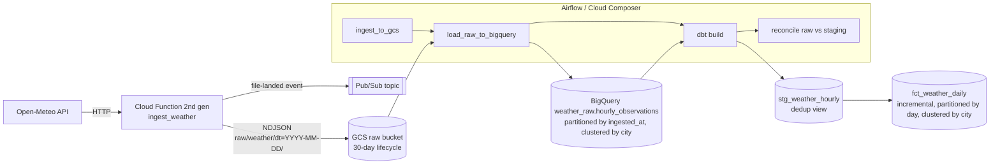

# GCP Weather Pipeline — end-to-end batch pipeline on Google Cloud

Production-style data pipeline that ingests hourly weather for five Chilean cities from the free
[Open-Meteo API](https://open-meteo.com/) and turns it into a partitioned, tested analytics table in BigQuery.

It is small on purpose, but it is built the way I build pipelines for clients: infrastructure as code,
idempotent loads, deduplication, data quality checks and a reconciliation step between layers.

## Architecture



| Layer | Tech | What it shows |
|---|---|---|
| Ingestion | Cloud Functions (Python), Cloud Storage, Pub/Sub | Validated parsing, Hive-style partitioned raw zone, event on landing |
| Orchestration | Apache Airflow / Cloud Composer | Retries with backoff, templated dates, idempotent daily runs |
| Warehouse | BigQuery | Partitioning + clustering, schema owned by Terraform, retention |
| Transformation | dbt (BigQuery adapter) | Dedup in staging, incremental `insert_overwrite` mart, generic + singular tests, source freshness |
| Quality | dbt tests + Airflow `BigQueryCheckOperator` | Uniqueness, ranges, min ≤ max, raw → staging reconciliation |
| Infrastructure | Terraform | APIs, least-privilege service account, private function (no public invoker), buckets, datasets, tables |
| CI | GitHub Actions | Unit tests, Python syntax check of the DAG, `terraform fmt` + `validate` |

## Design decisions

- **Raw zone is append-only.** Retries and backfills simply add files; `stg_weather_hourly` keeps the latest
  ingestion per `(city, observed_at)`, so nothing is double counted.
- **Cost control by design.** Raw table partitioned by load day and clustered by city; the mart is incremental and
  only rewrites the last two daily partitions; dbt profiles set `maximum_bytes_billed`.
- **The function is not public.** Only the identity in `invoker_member` (the Airflow service account) can call it.
- **Fail loudly, not silently.** A malformed API response raises before anything is written; the reconciliation
  task fails the DAG if any ingested hour is missing from the curated layer.

## Repository layout

```
ingestion/cloud_function/   main.py (HTTP entry point) + transform.py (pure, unit-tested logic)
orchestration/dags/         weather_pipeline.py
transformation/dbt/         sources, staging, marts, tests
infra/terraform/            all GCP resources + BigQuery schema
tests/                      pytest suite for the ingestion logic
```

## Run it

Prerequisites: a GCP project with billing, `gcloud`, Terraform ≥ 1.6, Python 3.12, dbt-bigquery.

```bash
# 1. Infrastructure
cd infra/terraform
cp terraform.tfvars.example terraform.tfvars   # set project_id and invoker_member
terraform init && terraform apply

# 2. One manual ingestion (authenticated call)
curl -X POST "$(terraform output -raw function_url)" \
  -H "Authorization: bearer $(gcloud auth print-identity-token)" \
  -H "Content-Type: application/json" -d '{"past_days": 1}'

# 3. Transform
cd ../../transformation/dbt
export GCP_PROJECT=<your-project>
dbt deps && dbt build --target prod

# 4. Tear everything down when done (keeps the bill at ~0)
cd ../../infra/terraform && terraform destroy
```

For Airflow, copy `orchestration/dags/` and `transformation/dbt/` into Composer (or a local
`docker compose` Airflow) and set the Variables listed at the top of the DAG file.

### Tests

```bash
pip install pytest
pytest tests -q
```

## Cost

Open-Meteo is free. With the defaults (5 cities × 48 h per run, one run a day) data volume is a few KB per day,
well inside the BigQuery and Cloud Storage free tiers. The main cost driver would be Cloud Composer; for a demo,
run Airflow locally and `terraform destroy` afterwards.
